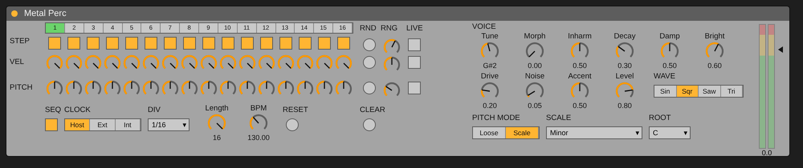

# m4l-metal-perc – Metallischer Percussion-Generator

Erstes Modul für das M4L-Rack (Variante A, siehe `KONZEPT.md`). Es ist eine Percussion-Voice mit
drei Klang-Engines, vier Wellenformen, einem 1-V/Oct-Quantizer und einem eingebauten 16-Step-Sequencer mit Randomizer.

> **Status:** Der Code wurde nicht in Max getestet, weil in der Entwicklungsumgebung kein Max/Live lief.
> Der Klang-Algorithmus ist über die Python-Referenz geprüft (`previews/*.wav`). Fehlermeldungen
> aus dem gen~-Compiler bitte melden (Max-Konsole, Zeilennummer). Sie lassen sich schnell beheben.

*Layout-Vorschau, aus den Positionen im Patch gerendert (`tools/render_layout.py`). Es ist kein echter Max-Screenshot, in Live sieht es ähnlich aus.*

## Dateien

| Datei | Inhalt |
|---|---|
| `metal_perc.maxpat` | Fertiges Patch für das M4L-Device (generiert) |
| `metal_perc.genexpr` | gen~-DSP-Code, im Patch bereits eingebettet (generiert, zum Lesen) |
| `seq_random.js` | Randomizer, schreibt neue Werte in die Step-Regler |
| `src/metal_perc.genexpr.in` | **Quelle** des DSP-Codes. Hier editieren, dann `python3 build.py` |
| `build.py` | Erzeugt `.genexpr` und `.maxpat` (16 Steps, UI, Verkabelung) |
| `reference/metal_perc_ref.py` | Python-Nachbau des DSP für Hörproben ohne Max |
| `previews/*.wav` | Hörproben (aus der Python-Referenz gerendert) |

## In Ableton Live laden

1. In Live eine leere **Max Instrument**-Spur anlegen (*Max for Live → Max Instrument*) und den Editor öffnen.
2. Im Device-Editor zuerst die Standard-Objekte des neuen Devices löschen (`midiin`, `midiout`, `plugout~`).
   Dann `metal_perc.maxpat` öffnen (*File → Open*), dort alles auswählen (Cmd/Strg+A), kopieren und in den
   Device-Editor einfügen. In den Patcher-Einstellungen *Open in Presentation* aktivieren.
3. Das Device als `Metal Perc.amxd` speichern, und zwar **in denselben Ordner wie `seq_random.js`**.
   Alternativ die JS-Datei in den Ordner des Devices kopieren. Danach *Freeze Device*, damit das JS eingebettet wird.
4. Transport starten. Der Sequencer läuft synchron zu Live (Clock = *Host*).

## Bedienung

### Sequencer (links)
- **STEP:** An/Aus pro Step. Darüber läuft die Positionsanzeige.
- **VEL / PITCH:** Velocity- und Pitch-Poti pro Step (Pitch ±24 Halbtöne).
- **SEQ:** Sequencer an/aus. Bei *aus* spielt die Voice nur über MIDI-Noten oder den Ext-Trigger.
- **CLOCK:** *Host* (Live-Transport), *Ext* (Clock-Signal an Eingang 2) oder *Int* (eigenes Tempo **BPM**).
- **DIV:** 1/8, 1/16, 1/32, 1/8T, 1/16T. **LENGTH:** 1–16 Steps. **RESET:** zurück auf Step 1.

### Randomizer (Mitte), eine Zeile je Spur (Steps / Velocity / Pitch)
- **Rnd** (Knopf): würfelt die Step-Regler einmal neu. Das Ergebnis ist sichtbar, editierbar und wird gespeichert.
  - Steps: Jeder Step ist mit der Wahrscheinlichkeit **Density** aktiv.
  - Velocity: Zufallswert zwischen (1 − **Range**) und 1.
  - Pitch: ganze Halbtöne zwischen −**Range** und +**Range**.
- **Live** (Schalter): würfelt bei *jedem Schlag* neu, ohne die Regler zu verändern. Gut für hypnotische Variation.
  - Steps: Aktive Steps spielen nur mit der Wahrscheinlichkeit **Density**.
  - Velocity / Pitch: Abweichung innerhalb von **Range**.
- **Clear:** alle Steps an, Velocity 1, Pitch 0.

### Pitch (unten rechts)
- **PITCH MODE:** *Scale* rastet die Gesamttonhöhe (Tune + Step-Pitch + CV + MIDI) auf die gewählte Skala ein.
  *Loose* lässt sie stufenlos.
- **SCALE:** Chromatic, Minor, Phrygian, Harmonic Minor, Minor Pentatonic, Dorian, Phrygian Dominant, Hirajoshi.
- **ROOT:** Grundton der Skala.
- **1 V/Oct:** Signal-Eingang 4. Laut Rack-Konvention gilt ±1.0 = ±5 V, also entspricht 0.2 einer Oktave.
  Der Wert wird beim Trigger gehalten (Sample & Hold), wie bei Drum-Modulen üblich.

### Oszillatoren (OSC, Mitte rechts)
| Regler | Wirkung |
|---|---|
| **Voices** | Anzahl aktiver Oszillatoren der Bank (1–6). Wenige klingen klarer und tonaler, viele dichter und metallischer |
| **Spread** | Abstand der Frequenzverhältnisse: 0 = alle auf dem Grundton, 1 = normal, 2 = doppelt so weit auseinander |
| **Detune** | Feste Verstimmung der Bank-Oszillatoren gegeneinander (0–50 Cent). Erzeugt Schwebungen |
| **Tilt** | Pegel der oberen Partials: − dunkel (Grundton dominiert), + hell (obere Oszillatoren lauter) |
| **PW** | Pulsbreite der Square-Welle (5–95 %). Schmale Pulse klingen nasal und dünn |
| **FM Ratio** | Frequenzverhältnis Modulator/Träger (0.5–8), unabhängig von Inharm. Ganze Zahlen klingen harmonisch, krumme Werte metallisch |
| **FM Amt** | FM-Index, also wie stark der Modulator den Träger verbiegt (folgt der Hüllkurve) |
| **FM FB** | Feedback des Modulators auf sich selbst. Von rau bis Rauschen |
| **Ring** | Mischung FM-Träger ↔ Ringmodulation |
| **Sweep / Sw Time** | Pitch-Hüllkurve: Tonhöhen-Sprung beim Anschlag (−24 bis +48 Halbtöne), der in Sw Time (1–500 ms) zurückläuft. Wirkt auf alle Engines |
| **Mod Wave** | Eigene Wellenform für den FM-Modulator |
| **Phase** | *Free*: Oszillatoren laufen frei, jeder Schlag klingt leicht anders. *Reset*: Phasen starten bei jedem Schlag neu, für einen gleichbleibenden, harten Anschlag |

### Voice (rechts)
| Regler | Wirkung |
|---|---|
| **Tune** | Grundton (MIDI-Note 24–96) |
| **Wave** | Sine / Square / Saw / Triangle für die Bank und den FM-Träger (Modulator: *Mod Wave*). Square und Saw sind polyBLEP-bandbegrenzt |
| **Morph** | 0 = **Bank** (6 Oszillatoren, 808-Cymbal-Prinzip) → 0.5 = **FM/Ring** → 1 = **Resonator** (4 Moden, Rauschimpuls) |
| **Inharm** | 0 harmonisch → 0.5 808-Metall-Verhältnisse → 1 Membran/Glocke |
| **Attack** | Anstiegszeit der Hüllkurve, 0.1–50 ms. Kleine Werte klingen hart und klickend, 3–10 ms weicher |
| **Decay** | 10 ms bis 2.5 s |
| **Damp** | Dämpfung der Resonator-Moden (nur Morph Richtung 1) |
| **Bright** | Filteröffnung der Bank und Helligkeit der Resonator-Anregung |
| **Drive** | tanh-Sättigung, pegelkompensiert |
| **Noise** | Hochpass-Rauschen, mit der Hüllkurve geformt |
| **Accent** | Wie stark die Velocity Decay und Helligkeit beeinflusst |
| **Level** | Ausgangspegel |

Im Resonator-Modus (Morph = 1) wirkt **Wave** nicht, weil die Moden durch Rauschen angeregt werden.

### MIDI
MIDI-Noten aus Live-Clips triggern die Voice direkt. C3 (60) = Tune, andere Noten transponieren relativ dazu.
Die Velocity wird übernommen.

## Signal-Ein-/Ausgänge des gen~-Kerns (für die Rack-Matrix)

| | Signal |
|---|---|
| in1 | Host-Beat-Phase (`plugphasor~`) |
| in2 | Ext Clock (steigende Flanke = 1 Step) |
| in3 | Ext Reset |
| in4 | Pitch CV 1 V/Oct |
| in5 | Ext Trigger (umgeht den Sequencer) |
| out1 | Audio |
| out2 | Hüllkurve 0..1 (als Mod-Quelle) |
| out3 | aktueller Step 0..15 |
| out4 | Gate/Trigger-Out (5 ms) |

Im Device sind in2 bis in5 noch nicht belegt. Die Anschlüsse sind für die spätere Routing-Matrix vorgesehen.

## Hörproben (`previews/`)

| Datei | Einstellung |
|---|---|
| `01_bank_hats_square` | Bank, Square, kurze Decay: metallische Hats |
| `02_fm_clank_saw` | FM/Ring, Saw, Pitch-Steps: Industrial-Clank |
| `03_resonator_pipes_phrygian` | Resonator, Live-Pitch in D Phrygian: Rohre/Bleche |
| `04_industrial_drive_tri` | Bank→FM, Triangle, viel Drive und Noise, Live-Velocity |
| `05_hypnotic_random_sine` | FM→Resonator, Sine, Live-Steps und Live-Pitch (Moll-Pentatonik) |
| `06_waveforms_sine_square_saw_tri` | Derselbe Schlag nacheinander mit allen 4 Wellenformen |
| `07_osc_sweep_feedback_pulse` | FM mit Pulse (PW 0.2), Saw-Modulator, viel Feedback, Pitch-Sweep +36, Phase Reset |
| `08_osc_bank_voices_spread_detune` | Bank mit 3 Oszillatoren, Spread 1.6, Detune 25 Cent, Tilt hell, PW 0.3 |
| `09_lowmid_fm_metal` | Preset *Low/Mid FM Metal* im Pattern (G Phrygian) |
| `10_lowmid_fm_metal_hits_G1_D2_G2` | Preset *Low/Mid FM Metal* als Einzelschläge auf G1, D2, G2 |

Die Hörproben sind normalisiert. Neu rendern mit `python3 reference/metal_perc_ref.py`.

## Preset: Low/Mid FM Metal

Tiefe bis mittlere FM-Percussion aus zwei Sinus-Oszillatoren: Ein Sinus-Modulator verbiegt einen Sinus-Träger.
Die FM Ratio 2.76 entspricht dem Obertonverhältnis eines schwingenden Metallstabs. Dadurch entstehen unharmonische,
metallische Seitenbänder über einem Grundton von G1 (~98 Hz). Etwa 60 % der Energie liegen unter 1 kHz.

| Bereich | Einstellung |
|---|---|
| Voice | Tune **43** (G1) · Morph **0.50** (reine FM) · Wave **Sin** · Attack **4 ms** · Decay **0.38** · Accent **0.60** · Drive **0.20** · Noise **0** · Level 0.80 |
| OSC | Mod Wave **Sin** · FM Ratio **2.76** · FM Amt **0.90** · FM FB **0** · Ring **0.70** · Sweep **+5 st** · Sw Time **40 ms** · Phase **Free** |
| Pitch | Mode **Scale** · Scale **Phrygian** · Root **G** |
| Pattern | Steps `1001 0010 0100 1010` · Pitch +1 auf Step 4, −2 auf Step 10, +3 auf Step 13 · Velocity leicht akzentuiert |

**Gegen Klicks:**
- **Attack** 3–6 ms statt eines sofortigen Sprungs.
- **Phase Free**: Mit *Reset* springen die Phasen in einen noch klingenden Ausklang, das klickt.
- **Kürzerer Sweep**: wenig Halbtöne, langsam.

Gemessen (Transienten-Spitze über 5 kHz gegenüber dem Ausklang): vorher +21 dB, jetzt etwa 0 dB.

Varianten:
- **FM Ratio 3.53** klingt noch metallischer und glockiger.
- **FM Ratio 1.73** klingt tiefer und tonaler.
- **FM FB** ist die Hauptquelle von Rauschen. Für einen sauberen Klang auf 0 lassen, für Rauheit 0.2–0.4.
- **Attack 6–10 ms** macht den Anschlag noch weicher, eher Mallet-artig.

## Bekannte Grenzen
- **Host-Clock:** Der Sequencer zählt Beats ab dem Transport-Start. Wenn du mitten im Takt startest, beginnt
  das Pattern dort mit Step 1. Bei Bedarf hilft RESET.
- **Daisy-Port (oopsy):** Der DSP ist reines gen~ und damit portierbar. Die 91 Parameter brauchen auf
  Hardware aber ein eigenes Bedienkonzept.
- Das Layout ist funktional und noch nicht gestaltet.
